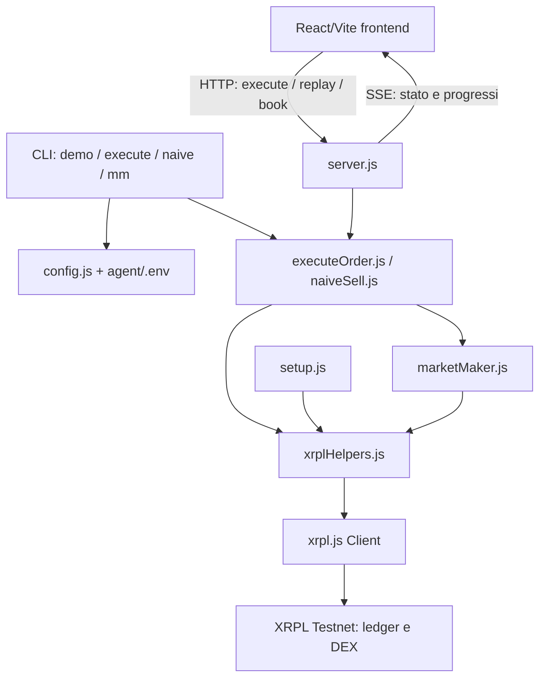

# HoldIt! — guida al progetto

> Documento di orientamento e apprendimento per la repository **IXH26-project**. Descrive ciò che è presente nel codice, spiega i concetti XRPL necessari per leggerlo e separa l’implementazione attuale dalle idee di prodotto ancora da realizzare. Aggiornare questa guida quando cambiano architettura, flussi o comportamento.

## Indice

1. [In breve e percorso rapido](#1-in-breve)
2. [Stato del progetto](#2-stato-del-progetto-implementato-e-previsto)
3. [Mappa della repository](#3-mappa-della-repository)
4. [Architettura](#4-architettura-e-dipendenze-tra-moduli)
5. [Concetti XRPL](#5-concetti-xrpl-utili-per-leggere-il-codice)
6. [Wallet e ciclo della demo](#6-i-tre-wallet-e-il-ciclo-della-demo)
7. [Motore naive e guarded](#7-come-funziona-il-motore-guarded)
8. [Eventi, bridge e frontend](#8-eventi-dellengine-e-bridge-web)
9. [Avvio e comandi](#9-avvio-e-comandi)
10. [Configurazione](#10-configurazione)
11. [Limiti e lettura dei risultati](#11-note-operative-e-limiti-interpretativi)
12. [Manutenzione della guida](#12-come-mantenere-questa-guida)
13. [Glossario](#13-glossario-e-basi)

## 1. In breve

HoldIt! è una prova di concetto di un execution engine per vendere un token IOU sul DEX nativo di XRP Ledger (XRPL). Il problema modellato è quello di una tesoreria che vende una quantità elevata: un ordine grande può consumare i bid migliori e ottenere prezzi progressivamente peggiori, cioè subire slippage.

Il progetto rende confrontabili due strategie:

- **Naive**: un unico ordine di vendita per l’intera quantità, senza soglia di prezzo.
- **Guarded**: misura il book, calcola un prezzo minimo in base alla tolleranza scelta e vende in chunk con un limite verificato dal ledger.

La demo gira su **XRPL Testnet** e usa un market maker controllato dal progetto per creare e ricostituire la liquidità. Di conseguenza, dimostra il comportamento del meccanismo in un mercato simulato, non una performance su liquidità reale.

### Percorso rapido

1. `setup.js` prepara tre account di test e il token TGD.
2. `marketMaker.js` pubblica i bid che rappresentano la liquidità del mercato dimostrativo.
3. `naiveSell.js` esegue una vendita unica; `executeOrder.js` prova invece una vendita protetta a tranche.
4. `demo.js` confronta le strategie da terminale. In alternativa, `server.js` espone le stesse operazioni al frontend React.
5. Il frontend mostra book, avanzamento e risultati; `server.js` può anche riprodurre run registrati senza collegarsi al ledger.

Per orientarsi, leggere prima le sezioni 3–4 (file e collegamenti), poi 6–8 (flusso e comportamento) e infine 9–11 (avvio, configurazione e limiti). Il glossario della sezione 13 è un riferimento per i termini XRPL.

## 2. Stato del progetto: implementato e previsto

### Presente nella repository

- Agente Node.js con `xrpl.js` per connettersi alla Testnet, preparare wallet e token, leggere il book e inviare transazioni.
- Market maker dimostrativo che pubblica un ladder di bid a prezzi configurati e ripristina i livelli consumati.
- Vendita naive e motore di vendita protetta con prezzo minimo, chunk adattivi, attesa della liquidità e riepilogo dei fill.
- Demo CLI che esegue il confronto tra le due strategie.
- Bridge HTTP locale con endpoint per stato, book, reset, esecuzione e replay; gli aggiornamenti sono trasmessi con Server-Sent Events (SSE).
- Frontend MVP in React e Vite con pannelli naive/guarded, campi per importo e tolleranza, book bid, replay registrati e aggiornamenti di esecuzione via SSE.
- Controllo pre-demo (`doctor.js`) che verifica runtime, configurazione locale, connessione Testnet, wallet, liquidità e bridge.
- Test automatici offline per helper XRPL e contratto HTTP del bridge, più test d’integrazione che inviano transazioni alla Testnet.
- Test unitari offline del riduttore di stato del frontend.
- Replay offline di esecuzioni registrate, con due esempi curati e salvataggio locale dei run live.
- Runbook con preparazione, sequenza sul palco, piani di emergenza e diagnosi dei problemi.

### Non presente ancora

- Deposito o custodia di token da parte di utenti, gestione di mandati multiutente o un backend di produzione.
- Protezione privata o garanzia contro front-running/MEV. L’ordine, la soglia e le transazioni XRPL restano visibili secondo il normale funzionamento del ledger.
- Esecuzione automatica dei test in CI: nessuna pipeline lancia i test. I test live, avversario e del browser vanno eseguiti a mano, perché inviano transazioni reali sul testnet.

Il README di root presenta il pitch e rimanda ai documenti operativi. Questa guida descrive il comportamento verificabile nei moduli del repository; il runbook è invece orientato alla demo e i README di `agent/` e `frontend/my-app/` raccolgono istruzioni rapide per ciascun package.

## 3. Mappa della repository

| Percorso | Responsabilità |
|---|---|
| `README.md` | Pitch, problema, proposta di soluzione e limiti dichiarati del prototipo. |
| `agent/README.md` | Avvio rapido, comandi, configurazione, note XRPL e API del bridge. |
| `agent/package.json` / `agent/package-lock.json` | Dipendenze, comandi npm, versione minima Node e lock delle dipendenze. |
| `agent/config.js` | Carica `agent/.env`, definisce rete, token, wallet e parametri del book e dell’esecuzione. |
| `agent/.env.example` | Esempio documentato delle variabili; i seed reali vengono salvati in `agent/.env`. |
| `agent/setup.js` | Crea i tre wallet di test, configura l’issuer, crea trust line, emette token e salva i seed. |
| `agent/xrplHelpers.js` | Connessione, formattazione importi, lettura book e saldi, analisi dei fill, invio batch e top-up. |
| `agent/marketMaker.js` | Crea, rifinanzia e descrive i bid del market maker simulato. |
| `agent/naiveSell.js` | Un singolo ordine di vendita senza floor e stampa del riepilogo. |
| `agent/executeOrder.js` | Algoritmo guarded, eventi di avanzamento e riepilogo finale. |
| `agent/demo.js` | Esecuzione end-to-end naive vs guarded sul book dimostrativo. |
| `agent/server.js` | Bridge HTTP/SSE per collegare un client web locale all’engine. |
| `agent/doctor.js` | Controlli di preparazione prima della demo; termina con codice 1 se trova un blocco. |
| `agent/test/xrplHelpers.test.js` | Test offline per conversioni, costruzione IOU, prezzo dei bid e gestione di fill uccisi. |
| `agent/test/server.test.js` | Test offline per risposte HTTP, validazione input, CORS, lock, replay e modalità offline. |
| `agent/test/live.test.js` | Cinque test d’integrazione XRPL Testnet per ladder, vendita guarded, price floor e contratto eventi naive e guarded. |
| `agent/test/adversary.live.test.js` | Tre test Testnet sull’effetto di un book spostato prima della vendita e sul riferimento di prezzo ancorato. |
| `agent/test/fixtures/fill-1000.json` | Metadati validati di una vendita Testnet usati dal test unitario di `parseFill()`. |
| `frontend/my-app/package.json` / `package-lock.json` | App separata React 19 + Vite 8, Tailwind CSS 4, ESLint e script dev/build/lint/test. |
| `frontend/my-app/index.html`, `src/main.jsx`, `vite.config.js` | Entrata dell’app browser e configurazione del dev server/build Vite. |
| `frontend/my-app/src/App.jsx` | Schermata principale: importo, mandato, stato bridge e pannelli delle due strategie. |
| `frontend/my-app/src/lib/bridge.js` | Client browser HTTP/SSE verso il bridge; il browser non riceve i seed. |
| `frontend/my-app/src/hooks/useBridge.js` | Apre lo stream SSE, aggiorna lo stato e invia `POST /execute`. |
| `frontend/my-app/src/lib/runState.js` | Riduttore puro che trasforma hello/run/eventi in stato per i pannelli. |
| `frontend/my-app/src/components/` | Barra di stato, pannelli naive/guarded, book e comandi replay. |
| `frontend/my-app/src/components/OrderBookPanel.jsx` / `ReplayBar.jsx` | Tabella dei bid con barre di profondità e pulsanti per le due registrazioni demo. |
| `frontend/my-app/src/hooks/useBook.js` / `src/lib/book.js` | Polling del book e trasformazione dei bid in righe e profondità. |
| `frontend/my-app/src/lib/book.test.js` | Cinque test offline per righe, barre di profondità, limite livelli e profondità totale. |
| `frontend/my-app/src/lib/format.js` / `format.test.js` | Formattazione in inglese delle quantità TGD (es. 100,000) e relativi test. |
| `frontend/my-app/src/lib/runState.test.js` | Nove test unitari offline per routing eventi, stati, errori e replay. |
| `frontend/my-app/e2e/ui.e2e.test.mjs` | Test browser end-to-end separati: usano bridge e UI e inviano una vendita al Testnet. |
| `frontend/my-app/src/index.css` | Tema Tailwind e palette dell’interfaccia. |
| `images/HoldIt!.png`, `frontend/my-app/public/favicon.svg` | Marchio del README e favicon della UI. |
| `docs/HoldIt_pitch.pdf` | Materiale di pitch del progetto; non è codice eseguito dall’app. |
| `agent/recordings/demo-naive.json`, `agent/recordings/demo-guarded.json` | Registrazioni curate per riprodurre le demo senza connessione XRPL. |
| `agent/recordings/live/` | Registrazioni create dal bridge dopo un run live; cartella esclusa da Git. |
| `docs/DEMO_RUNBOOK.md` | Checklist operativa per il giorno della demo, inclusi uso del frontend, replay offline e troubleshooting. |
| `docs/PITCH_MEV_NOTE.md` | Nota per il pitch: distingue le affermazioni supportate, le cautele e i limiti della demo sul tema MEV/front-running. |
| `agent/connect-test.js` | Smoke check manuale di connessione e faucet Testnet. |
| `docs/` | Guida progetto, runbook operativo e nota MEV per il pitch. |

## 4. Architettura e dipendenze tra moduli



`config.js` è importato dai moduli e fornisce configurazione condivisa. `xrplHelpers.js` contiene le operazioni XRPL riutilizzabili. `executeOrder.js`, `naiveSell.js`, `marketMaker.js` e `server.js` possono essere importati senza avviare nulla: `isMain(import.meta.url)` fa partire `main()` solo quando il file viene eseguito direttamente. `demo.js`, `setup.js`, `doctor.js` e `connect-test.js` non hanno questa protezione: eseguono il comando appena vengono importati, quindi non vanno importati da altri moduli. Questa separazione permette a `server.js` di comporre le funzioni dell’engine.

Il frontend vive nel proprio package e si installa dalla directory `frontend/my-app/`. Il browser parla soltanto col bridge HTTP locale; le credenziali wallet restano nel processo Node. Il repository non ha un package manager/workspace alla root: agent e app frontend hanno lockfile e dipendenze distinti.

Dipendenze runtime dichiarate: `xrpl` 5.x e `dotenv`; il progetto richiede Node.js 20.19 o successivo. Il bridge usa `node:http` e `node:crypto` integrati in Node, senza framework HTTP aggiuntivi. I test usano `node:test` e `node:assert` integrati in Node.

Per accelerare la pubblicazione del ladder, `submitMany()` usa un solo `autofill()` per ricavare fee, `LastLedgerSequence` e sequenza iniziale; firma le transazioni con sequenze consecutive e le invia in parallelo in batch fino a 10. Aspetta poi la validazione di ogni hash. Questa ottimizzazione riduce i round trip necessari al seeding, ma dipende dal comportamento della coda transazioni di XRPL.

## 5. Concetti XRPL utili per leggere il codice

### XRP, drop e IOU

XRP è l’asset nativo e nelle transazioni viene espresso in **drop**: 1 XRP = 1.000.000 drop. `toDrops()` converte gli XRP in una stringa di drop interi. Il token TGD della demo è invece un **IOU** (un asset emesso da un account issuer) e viene identificato dalla coppia `currency` + `issuer`, con importo rappresentato come oggetto `{ currency, issuer, value }`.

Il ticker standard XRPL è lungo tre caratteri; `TGD` rispetta questa regola. La stringa `TOKEN` richiederebbe una rappresentazione valuta estesa. `formatIou()` evita notazione esponenziale e limita le cifre significative nel serializzare gli importi.

### Issuer e trust line

L’**issuer** emette il token. Un altro account deve creare una **trust line** verso quell’issuer prima di poter detenere l’IOU. `setup.js` prepara issuer, tesoreria e market maker; imposta `asfDefaultRipple` sull’issuer prima di creare le trust line, poi crea le linee per tesoreria e market maker e trasferisce i token alla tesoreria.

Questi wallet e seed sono soltanto per Testnet. `.gitignore` esclude i file `.env`; `agent/.env.example` è un modello senza seed. Non inserire mai seed Mainnet in questa configurazione.

### OfferCreate e direzione del book

Un `OfferCreate` specifica cosa l’account cede (`TakerGets`) e cosa vuole ricevere (`TakerPays`). Nel book usato dal progetto i bid sono offerte di compratori che pagano XRP per ricevere TGD. Di conseguenza `getBids()` richiede XRP in `taker_gets` e TGD in `taker_pays`.

`book_offers.quality` non viene usato come prezzo XRP/TGD: la sua unità è token per drop in questa direzione del book. `getBids()` ricava il prezzo come `XRP / token` dagli importi dell’offerta, usando i campi funded quando presenti per riflettere la quantità realmente finanziata.

### IOC, Sell e validazione

Le vendite usano `tfImmediateOrCancel` (IOC): l’offerta viene eseguita subito per la parte abbinabile e la parte restante viene annullata, quindi non resta come ordine aperto nel book. `tfSell` indica che l’ordine vende l’intero importo `TakerGets`, anche se ottiene più XRP dell’importo richiesto in `TakerPays`. Senza `tfSell`, invece, l’ordine si ferma appena ha ricevuto l’importo `TakerPays`: nel test del 20/11/2026, con 0,05 XRP come minimo, ha venduto 500 token invece di 1.000.

Le transazioni vengono inviate al ledger e poi misurate dai metadati validati. `parseFill()` usa `xrpl.getBalanceChanges()` per determinare quanti token sono usciti e quanti XRP sono entrati; riaggiunge la fee XRP alla variazione di saldo per stimare i proventi della vendita al lordo della fee. Questo evita di basare il riepilogo soltanto su quantità richieste o prezzi teorici.

## 6. I tre wallet e il ciclo della demo

1. `npm run setup` crea **issuer**, **treasury** e **market maker** tramite faucet Testnet. Finanzia anche il market maker per sostenere gli XRP del ladder e le riserve di account (1 XRP di base più 0,2 XRP per ogni oggetto posseduto, come offerte e trust line: vedere il glossario, sezione 13).
2. Tesoreria e market maker creano le trust line verso l’issuer; l’issuer invia TGD alla tesoreria.
3. `seedLadder()` pubblica un livello di bid per ogni configurazione in `LADDER`. Il market maker usa `OfferSequence` per sostituire atomicamente gli ordini esistenti dove possibile e cancella eventuali offerte in eccesso.
4. La vendita naive consuma il book con un unico IOC. Poiché il ladder ha livelli più bassi, un ordine grande può ricevere un prezzo medio inferiore al prezzo di riferimento.
5. La demo ripristina il ladder e avvia il ciclo di refill del market maker. L’engine guarded esegue chunk limitati dal prezzo minimo mentre il market maker reintegra i livelli consumati ai prezzi configurati.
6. Al termine, la demo confronta token venduti, XRP ricevuti, prezzo medio, slippage e durata.

Il market maker non rappresenta domanda indipendente: è un attore controllato dal progetto e ripristina la liquidità a prezzi fissi. Questa ipotesi spiega perché il percorso guarded può apparire molto migliore nella demo. Senza refill, la suddivisione da sola non crea liquidità né migliora il prezzo medio rispetto alla profondità disponibile.

## 7. Come funziona il motore guarded

In `executeOrder(client, wallet, totalAmount, maxSlippagePercent, options)`, i valori percentuali sono espressi come numeri percentuali: `0.5` significa 0,5%.

1. **Controllo saldo e book**: legge il saldo token della tesoreria e rifiuta quantità superiori; poi legge i bid. Un book vuoto interrompe l’esecuzione.
2. **Prezzo di riferimento**: di default è il miglior bid iniziale. L’opzione `referencePrice` lo ancora a un prezzo scelto prima della vendita; bridge, demo e CLI passano `BASE_PRICE` sia alla guarded sia alla naive, quindi né il floor né lo slippage si spostano con il book.
3. **Price floor**: calcola `minPrice = referencePrice × (1 − maxSlippagePercent / 100)`. Per esempio con 0,5%, la vendita non accetta offerte inferiori al 99,5% del prezzo di riferimento.
4. **Liquidità in banda**: prima di ogni chunk rilegge i bid ed esclude quelli posseduti dalla tesoreria. Somma i token disponibili con prezzo `>= minPrice`.
5. **Attesa o stop**: se la liquidità sicura è inferiore al minimo necessario, aspetta e ripete la lettura ogni `POLL_MS`. Se non torna entro `LIQUIDITY_TIMEOUT_MS`, termina `halted`, potenzialmente con fill parziale.
6. **Dimensione del chunk**: limita la vendita al rimanente e a `CHUNK_MAX`; normalmente usa `PARTICIPATION` della liquidità in banda, con un minimo coerente con `MIN_CHUNK`.
7. **Ordine protetto**: invia un `OfferCreate` IOC + Sell, offrendo il chunk di TGD e impostando `TakerPays` a `chunk × minPrice` XRP. Il rapporto tra importo venduto e importo XRP richiesto definisce il limite di cambio dell’ordine, che viene valutato dal ledger; il motore non si affida soltanto a una decisione lato JavaScript.
8. **Contabilità e progressi**: dopo la validazione legge i metadati, aggiorna totale venduto e XRP ricevuti e calcola prezzo medio, slippage e percentuale completata.
9. **Condizioni di arresto**: un chunk senza fill viene conteggiato come kill; dopo cinque kill consecutivi l’esecuzione si ferma. L’engine verifica anche lo slippage medio come salvaguardia e chiude con evento `done`.

La soglia on-chain limita il prezzo accettato per i chunk. L’engine può comunque terminare senza vendere tutta la quantità se non c’è liquidità sicura o se il tempo di attesa scade. Il campo `status` del riepilogo distingue `completed` da `halted`; controllare anche `sold`, `reason` e `slippagePct` prima di interpretare un run come completato integralmente.

### Strategia naive

`naiveSell()` usa un singolo ordine IOC + Sell per tutti i token richiesti e imposta `TakerPays: "1"` drop: in pratica non impone una soglia economica significativa. Può quindi attraversare più livelli del book fino alla quantità disponibile. La funzione accetta `referencePrice` come la guarded; bridge, demo e CLI passano `BASE_PRICE`. Restituisce i dati osservati dai metadati, il riferimento e lo slippage rispetto a quel riferimento. Nel suo riepilogo `status: "completed"` significa che c’è stato un fill; non garantisce che sia stata venduta tutta la quantità. Confrontare sempre `sold` con `totalAmount`.

## 8. Eventi dell’engine e bridge web

`executeOrder()` accetta `onEvent`; per impostazione predefinita `logEvent()` stampa gli eventi nel terminale. Gli eventi guarded sono `start`, `waiting`, `killed`, `chunk`, `halt` e `done`; `chunk` include progresso, quantità, XRP ricevuti, prezzo medio, slippage e hash della transazione. Anche `naiveSell()` accetta `onEvent` e restituisce la stessa forma utile al client: `start`, un singolo `chunk` se c’è un fill, e `done`. In caso di zero fill restituisce `status: "halted"` e non emette `chunk`.

Tutti gli eventi dell’engine hanno il campo `mode`, valorizzato a `"naive"` o `"guarded"`; anche l’evento `seeding` del bridge identifica la modalità. Il client può quindi instradare gli aggiornamenti in base a `mode`, indipendentemente da quale schermata o richiesta li abbia avviati. Nell’evento `start` naive, `maxSlippagePercent` è `null` e `minPrice` è `0`: quella modalità non ha un floor, quindi il client non deve formattare il valore nullo come numero.

`server.js` espone una piccola API locale:

| Metodo e percorso | Comportamento |
|---|---|
| `GET /health` | Stato online/offline e occupato/libero, run corrente, ultimo run e numero di subscriber SSE. |
| `GET /book` | Bid correnti e configurazione del ladder. |
| `POST /reset` | Ripubblica il ladder in background; risponde `202` con `runId`. |
| `POST /execute` | Avvia modalità `naive` o `guarded`; risponde `202` e trasmette l’avanzamento. |
| `POST /replay` | Riproduce una registrazione curata senza interagire con il ledger; risponde `202`. |
| `GET /events` | Stream SSE; invia `hello`, `run:start`, eventi dell’engine e `run:end`. |

`POST /execute` accetta `{ "mode": "naive" | "guarded", "amount": numero, "maxSlippage": percentuale, "reset": boolean }`. Un solo reset o run può essere attivo; richieste concorrenti ricevono `409`. Il server verifica JSON, dimensione del body, intervalli numerici e origine browser consentita. Le richieste senza header `Origin` (ad esempio curl) sono ammesse. Le richieste `POST` devono avere `Content-Type: application/json`. Gli origin predefiniti includono localhost e 127.0.0.1 sulle porte 3000 e 5173, quindi Vite funziona senza modificare `ALLOWED_ORIGINS`.

Il server si mette in ascolto e poi tenta la connessione XRPL e il caricamento dei wallet, con un timeout di 10 secondi; se fallisce, il server resta avviato offline. Prima dell’esecuzione live fa un top-up della tesoreria se necessario. La modalità naive ripristina il ladder per default (`reset: false` lo disabilita); la guarded parte sempre da un ladder nuovo e fa girare il market maker durante la vendita. L’evento `seeding` segnala la preparazione del book, attualmente circa 8–10 secondi sulla Testnet. Entrambe le modalità live emettono eventi di esecuzione compatibili: la naive usa un solo chunk, la guarded può usarne diversi. Per il pannello del book, il polling di `/book` resta utile.

Il bridge è pensato per sviluppo locale, non è un servizio multiutente o un endpoint di produzione. `SERVER_HOST` è `127.0.0.1` per default; gli origin ammessi non sostituiscono un sistema di autenticazione se il servizio venisse esposto oltre il computer locale.

### Registrazione e replay

Durante un’esecuzione live, il bridge registra gli eventi engine con il tempo trascorso, i parametri e il risultato finale. Al completamento riuscito salva un JSON in `agent/recordings/live/`, escluso da Git. I run falliti non vengono salvati, e i replay non vengono registrati di nuovo. Le registrazioni curate nella radice di `agent/recordings/` vengono servite da `POST /replay`; i nomi accettano solo lettere, numeri e trattini, così non possono selezionare percorsi arbitrari.

Il body è `{ "name": "demo-guarded", "speed": 1 }`. `speed` deve essere maggiore di 0 e al massimo 100; il default è 1. Gli intervalli lunghi sono comunque accorciati a 2,5 secondi, quindi il replay mantiene la forma temporale degli eventi ma può essere più breve della registrazione originale. Il replay acquisisce il lock come `kind: "execute"`, conserva la forma generale dei parametri live e termina con `run:end`; il frontend può riutilizzare il normale flusso SSE.

Le registrazioni attualmente incluse sono esempi fissati, non dati di mercato aggiornati. `demo-naive` registra 100.000 TGD venduti, 8,644 XRP ricevuti e circa 13,56% di slippage; la registrazione ora include gli eventi `seeding`, `start`, `chunk` e `done`, tutti marcati `mode: "naive"`. `demo-guarded` registra 100.000 TGD venduti in 6 chunk, 9,99 XRP ricevuti e circa 0,11% di slippage con mandato 0,5%; anche i suoi eventi identificano `mode: "guarded"`. Sono riproduzioni di demo su Testnet con liquidità simulata, non risultati garantiti per un run nuovo.

### Modalità offline

`npm run server -- --offline` avvia il bridge senza tentare la connessione XRPL. Senza questo flag il bridge prova a connettersi per 10 secondi, poi rimane in modalità offline se la connessione fallisce. Lo stato `online` è esposto da `/health` e dall’evento SSE `hello`.

In offline, `/health`, `/events` e `/replay` restano utilizzabili. `GET /book` restituisce il ladder configurato con `offline: true`, quindi è una rappresentazione statica, non il book corrente del ledger. `POST /execute` e `POST /reset` rispondono `503` e indicano di usare il replay. Per tornare online occorre riavviare il server con rete e credenziali disponibili.

### Interfaccia React/Vite

L’app è in `frontend/my-app/`, separata dal package Node dell’agente. Usa React per componenti e stato, Vite per dev server/build e Tailwind CSS 4 per il layout e la palette. Installazione e avvio:

```bash
cd frontend/my-app
npm ci
npm run dev
```

Il browser usa `VITE_BRIDGE_URL` (default `http://127.0.0.1:8787`) per `POST /execute`, `POST /replay`, `GET /book` e `GET /events`. `bridge.js` incapsula fetch JSON, letture JSON e `EventSource`; `useBridge.js` collega lo stream al reducer `runState.js`. Il browser non importa `xrpl.js` e non riceve seed.

`App.jsx` propone quantità iniziale 100.000 TGD e mandato 0,5%, e disabilita i pulsanti di vendita mentre il bridge è disconnesso, offline o occupato. `StatusBar` mostra la connessione; `NaivePanel` presenta fill e slippage della vendita singola; `GuardedPanel` presenta progress bar, slippage e log dei chunk. `OrderBookPanel` mostra i bid in tabella, profondità per livello e profondità aggregata; `useBook` legge `GET /book` all’avvio, ogni 3 secondi e dopo la fine di un run. In offline il bridge restituisce un ladder configurato, marcato `offline: true`, non dati live.

`ReplayBar` offre replay naive e guarded, chiamando `POST /replay` tramite `useBridge`; i pulsanti funzionano anche offline quando il bridge è connesso e libero. Il reducer separa le strategie tramite `mode`, ricostruisce i run da `hello` e dagli eventi, ignora i run di solo `reset` e mostra gli errori HTTP o di rete. `formatTokens()` rende i gruppi delle migliaia in formato inglese (100,000). I 16 test di `npm test` sono unitari Node per stato, trasformazione book e formattazione; la suite browser separata `npm run test:e2e` fa una vendita live sul Testnet. I comandi sono `npm run dev`, `npm run build`, `npm run lint`, `npm test` e `npm run test:e2e`.

## 9. Avvio e comandi

Requisiti: Node.js >= 20.19 e dipendenze installate. La Testnet e `agent/.env` con i seed servono per setup, demo live, market maker ed esecuzione live; replay e server offline funzionano senza wallet o connessione XRPL.

```bash
cd agent
npm ci
npm run setup
npm run demo
```

`setup` crea le credenziali una volta e rifiuta di sovrascrivere seed già presenti. `npm run setup -- --force` crea un nuovo set e aggiorna `agent/.env`.

| Comando da `agent/` | Uso |
|---|---|
| `npm run connect-test` | Verifica connessione e faucet. |
| `npm run setup` | Inizializza wallet e token di test. |
| `npm run mm` | Pubblica il ladder e lo ricarica continuamente; Ctrl+C per fermare. |
| `npm run mm -- --seed` | Pubblica una volta e termina. |
| `npm run naive -- 100000` | Esegue una vendita naive. |
| `npm run execute -- 100000 0.5` | Esegue guarded; avviare prima `npm run mm` in un altro terminale. |
| `npm run execute -- 100000 0.5 --with-mm` | Avvia market maker e guarded nello stesso processo. |
| `npm run demo` | Confronto end-to-end naive e guarded. |
| `npm run server` | Avvia il bridge locale su `127.0.0.1:8787`. |
| `npm run server -- --offline` | Avvia il bridge senza contattare Testnet; disponibile il replay e un book statico. |
| `npm test` | Esegue i test offline definiti in `agent/test/`; non invia transazioni né contatta il ledger. |
| `npm run test:live` | Esegue 5 test d’integrazione su Testnet; richiede seed in `.env`, invia transazioni e ripristina il ladder alla fine. Dura circa 55 secondi e non è incluso in `npm test`. |
| `npm run doctor` | Controlla se ambiente e Testnet sono pronti per la demo; warning non bloccanti non causano codice d’uscita 1. |
| `npm run test:adversary` | Esegue 3 test sul testnet: un attaccante svuota i bid prima della vendita guarded. Verifica che il floor ancorato blocchi la vendita e documenta il limite del riferimento di default. Circa 90 secondi. |

Dal frontend, in `frontend/my-app/`, `npm test` esegue 16 test unitari offline, `npm run build` crea `dist/` e `npm run lint` lancia ESLint. Questi comandi hanno package e dipendenze indipendenti da `agent/`.

Il risultato numerico riportato in `agent/README.md` è un esempio registrato su Testnet, non un benchmark stabile: book, validazione, faucet e stato di rete possono variare.

## 10. Configurazione

Le variabili sono lette da `agent/.env`; i default e i commenti sono in `agent/.env.example`.

| Variabile | Significato |
|---|---|
| `XRPL_NETWORK` | URL WebSocket XRPL; default Testnet. |
| `TOKEN_CURRENCY`, `TOKEN_ISSUER` | Codice e issuer dell’IOU dimostrativo. |
| `ISSUER_SEED`, `TREASURY_SEED`, `MM_SEED` | Seed dei tre wallet Testnet, generati da `setup.js`. |
| `BASE_PRICE` | Miglior prezzo configurato del ladder, in XRP per token. |
| `LADDER_DROPS_PCT` | Ribasso percentuale di ciascun livello rispetto al prezzo base. |
| `LADDER_SIZES` | Quantità di token offerta in ogni livello; stessa lunghezza della lista dei ribassi. |
| `MM_INTERVAL_MS` | Intervallo del ciclo di controllo/refill. |
| `DEMO_AMOUNT`, `MAX_SLIPPAGE_PCT` | Valori predefiniti della demo e del mandato guarded. |
| `CHUNK_MAX`, `PARTICIPATION`, `MIN_CHUNK` | Tetto e logica di dimensionamento dei chunk. |
| `POLL_MS`, `LIQUIDITY_TIMEOUT_MS` | Frequenza di rilettura del book e attesa massima della liquidità. |
| `TREASURY_MINT` | Quantità minima emessa da `topUpTreasury()` quando il saldo della tesoreria non basta: la mint è il maggiore tra `TREASURY_MINT` e il mancante. |
| `SERVER_HOST`, `SERVER_PORT`, `ALLOWED_ORIGINS` | Binding, porta e origin browser consentiti dal bridge. |

I valori di `LADDER_DROPS_PCT` e `LADDER_SIZES` devono avere lo stesso numero di elementi. Il totale token del ladder è la somma delle size; gli XRP necessari dipendono da `size × price` per ogni livello, oltre a riserve ledger e fee.

Il frontend usa inoltre `VITE_BRIDGE_URL` (opzionale; default `http://127.0.0.1:8787`) per indirizzare il client web al bridge.

## 11. Note operative e limiti interpretativi

- **Il refill è l’assunzione centrale della demo.** Prezzi fissi e liquidità rigenerata sono intenzionali, ma non descrivono un market maker esterno che accetta di ricomprare a quei livelli.
- **Slippage qui è una metrica relativa al prezzo di riferimento.** Il codice calcola `(referencePrice - avgPrice) / referencePrice × 100`. Può risultare negativo se il prezzo medio supera il riferimento.
- **Fill parziale non equivale a ordine completato.** Controllare `status`, `reason` e quantità `sold` rispetto a `totalAmount`.
- **Il riferimento è ancorato al mandato.** Bridge, demo e CLI passano `BASE_PRICE`: se un attaccante svuota i livelli alti, il floor resta quello del mandato e la vendita si ferma senza vendere sotto. Il default di `executeOrder` (miglior bid all’avvio) resta vulnerabile: `npm run test:adversary` lo dimostra sul testnet.
- **Il prezzo-floor è applicato a ogni chunk.** Ciò protegge dal ricevere meno del limite per i fill dell’offerta; la disponibilità di liquidità e l’esito completo restano condizioni separate.
- **Il refill e i test di rete dipendono da Testnet e faucet.** Il faucet può essere rate-limited; il codice tenta il top-up e restituisce un errore leggibile se fallisce.
- **Ordini e dati di mercato sono pubblici.** Non descrivere l’attuale motore come privato o resistente al MEV. Sul rischio di front-running su XRPL, oggetto di un dibattito pubblico nel 2026, vedere `docs/PITCH_MEV_NOTE.md`.
- **Portata dei test.** `npm test` eseguito da `agent/` copre 24 casi offline (8 su `xrplHelpers`, 16 sul bridge), inclusa la lettura di un fixture di metadata reale; lo stesso comando da `frontend/my-app/` copre 16 test unitari di stato, book e formattazione. `npm run test:live` da `agent/` esegue 5 test sulla Testnet (livelli, vendita guarded, price floor diretto ed eventi naive/guarded), richiede seed e modifica temporaneamente il ledger di test. Il test nel browser (`npm run test:e2e` in `frontend/my-app/`) e il test avversario (`npm run test:adversary` in `agent/`) sono suite separate, lanciate a mano, con transazioni reali sul testnet.
- **Credenziali.** `agent/.env` è escluso da Git. Conservare solo seed Testnet e non condividere il file.

## 12. Come mantenere questa guida

Quando il progetto evolve, aggiornare in questo file almeno: mappa dei moduli, flusso end-to-end, parametri dell’engine, API bridge, stato delle funzionalità e limiti della demo. Se una parte futura diventa implementata, spostarla da “Non presente ancora” alla sezione pertinente e indicare dove si trova nel codice. Tenere `agent/README.md` focalizzato sull’avvio e sui dettagli operativi, e questa guida focalizzata sull’apprendimento e sul quadro complessivo.

## 13. Glossario e basi

Questa sezione spiega i termini usati nel progetto, a partire dalle basi della blockchain. Non serve conoscere XRPL per leggerla. I valori numerici sono quelli letti dal testnet il 20/11/2026 e possono cambiare.

### Basi della blockchain

- **Blockchain / ledger distribuito**: un registro condiviso, copiato su molti computer (nodi), che accetta solo transazioni firmate e ne mantiene un ordine unico. Nessuna parte controlla da sola il registro.
- **Ledger (XRPL)**: il registro di XRP Ledger. Ogni versione del registro chiusa e validata ha un indice numerico (`ledger_index`, o `seq`). Nel progetto il testnet produce un nuovo ledger circa ogni 4 secondi (misurato 3,8 secondi).
- **Nodo e validatore**: un nodo tiene una copia del registro. Un validatore è un nodo che partecipa al voto sulla versione successiva.
- **Consenso**: il meccanismo con cui i validatori concordano quale transazione entra nel ledger successivo. XRPL usa un proprio algoritmo di consenso.
- **Transazione**: un'istruzione firmata che modifica il registro, come un pagamento o la creazione di un'offerta.
- **Validata (finalità)**: una transazione è definitiva quando compare in un ledger validato. Il codice aspetta questo stato prima di leggere il risultato.
- **Account e indirizzo**: un account è una voce del registro. L'indirizzo è la sua parte pubblica, di solito inizia con `r`.
- **Seed**: il segreto da cui si derivano le chiavi di un account. Chi ha il seed controlla i fondi. Non va mai condiviso, né committato su git.
- **Wallet**: la coppia di chiavi derivata da un seed, che serve a firmare le transazioni.
- **Sequence (numero di sequenza)**: ogni account ha un contatore che cresce con le proprie transazioni. Una transazione va inviata con il numero successivo, quindi le transazioni di uno stesso account vanno in ordine.
- **LastLedgerSequence**: l'ultimo ledger in cui una transazione può essere inclusa. Dopo, la transazione scade.
- **Fee**: il costo di una transazione, pagato in XRP e distrutto dal protocollo, non versato a nessuno. Sul testnet la fee di base è 0,00001 XRP, cioè 10 drop.
- **Drop**: l'unità minima di XRP. 1 XRP = 1.000.000 drop. Gli importi XRP nelle transazioni sono in drop, come stringhe.
- **Riserva**: una quantità di XRP che l'account non può spendere, per ogni oggetto che possiede. Sul testnet: 1 XRP di base più 0,2 XRP per oggetto (offerte e trust line contano come oggetti). Un'offerta non blocca gli XRP che offrirebbe: la riserva riguarda solo l'oggetto.
- **Testnet e Mainnet**: il testnet è una rete di prova con XRP gratuiti, senza valore. La Mainnet ha valore reale. Il progetto funziona solo sul testnet.
- **Faucet**: il distributore gratuito di XRP di prova sul testnet. Ha limiti di richiesta: per questo il codice gestisce i top-up con un messaggio di errore leggibile.

### Token su XRPL

- **XRP**: il token nativo del ledger.
- **IOU**: un token emesso da un account chiamato **issuer**. Si identifica con la coppia `currency` + `issuer`. Il TGD del progetto è un IOU.
- **Codice valuta**: il nome del token. Un codice standard ha 3 caratteri.
- **Trust line**: l'autorizzazione con cui un account accetta di detenere un IOU di un certo issuer, fino a un limite. Senza trust line, l'account non può ricevere il token.
- **DefaultRipple**: impostazione dell'issuer che regola il modo in cui i token passano tra detentori. `setup.js` la imposta prima di creare le trust line.

### Mercato e liquidità

- **DEX (exchange decentralizzato)**: un mercato di scambio gestito dal protocollo, senza intermediari. Su XRPL è integrato nel ledger.
- **Order book**: l'elenco delle offerte aperte, con prezzo e quantità.
- **Bid**: un'offerta di acquisto. Il miglior bid è quella con il prezzo più alto.
- **Ask**: un'offerta di vendita. Il miglior ask è quella con il prezzo più basso.
- **Spread**: la differenza tra miglior ask e miglior bid.
- **Liquidità**: la quantità di offerte disponibili vicino al prezzo corrente. Più liquidità significa meno impatto su un ordine.
- **Market maker**: un operatore che mantiene offerte di acquisto e vendita per fornire liquidità. Nel progetto è simulato e ricarica i livelli consumati a prezzi fissi.
- **Ladder**: la serie di livelli di bid del market maker, con prezzi decrescenti e quantità definite in configurazione.
- **Price impact**: l'effetto di un ordine grande sul prezzo, perché consuma i livelli migliori.
- **Slippage**: la differenza tra il prezzo di riferimento e il prezzo medio ottenuto. Nel progetto: `(riferimento − prezzo medio) / riferimento × 100`.
- **AMM (automated market maker)**: un pool di liquidità con prezzo calcolato da una formula, invece che da un book di offerte. Il progetto non lo usa.

### Ordini e transazioni su XRPL

- **OfferCreate**: la transazione con cui si crea un'offerta nel book. Specifica cosa si cede (`TakerGets`) e cosa si vuole ricevere (`TakerPays`).
- **IOC (ImmediateOrCancel)**: l'offerta esegue subito la parte abbinabile e annulla il resto. Non resta nel book.
- **tfSell**: flag che vende l'intero importo `TakerGets`, anche se si ottiene più di `TakerPays`. Senza di esso, l'ordine si ferma appena riceve l'importo `TakerPays`: nel test del 20/11/2026, con 0,05 XRP come minimo, ha venduto 500 token invece di 1.000.
- **Limit price**: il prezzo minimo accettato da un'offerta, cioè il rapporto tra `TakerPays` e `TakerGets`. Nel progetto è il floor.
- **OfferSequence**: la transazione sostituisce un'offerta esistente con una nuova, in un'unica operazione.
- **Funded / unfunded**: un'offerta è finanziata nella misura in cui il proprietario ha il saldo per eseguirla. Il book mostra i campi `*_funded` per la quantità realmente eseguibile.
- **quality**: il rapporto tra gli importi nella direzione del book. Nella direzione usata dal progetto è token per drop, non il prezzo in XRP per token.
- **Metadata**: il dettaglio di una transazione validata, con i saldi prima e dopo. Il progetto legge da lì i fill reali (`getBalanceChanges`), invece di stimarli.
- **Codici di risultato**: `tesSUCCESS` è eseguita. `tecKILLED` è un IOC senza fill, cancellato. I codici `tec` sono transazioni incluse senza effetto utile, con fee pagata. `ter` significa in attesa di riprovare. `tem`, `tef` e `tel` indicano transazioni malformate, non incluse o errori locali: il codice le rifiuta.

### Sicurezza del prezzo e MEV

- **Front-running**: qualcuno anticipa una transazione altrui per trarne profitto.
- **Sandwich**: due transazioni attorno a quella di una vittima: una prima, che sposta il prezzo, e una dopo, che ne approfitta.
- **MEV (Maximal Extractable Value)**: il valore che un operatore può estrarre riordinando o includendo transazioni. Il termine nasce su Ethereum.
- **Mempool**: la lista di transazioni in attesa di inclusione, usata come concetto su Ethereum. Su XRPL il termine non è usato allo stesso modo: vedere `docs/PITCH_MEV_NOTE.md`.

Il rischio di front-running su XRPL è oggetto di dibattito pubblico (giugno 2026). Il progetto non lo elimina: il floor limita il prezzo di ogni fill, ma un attacco può ridurre la quantità eseguita. Il test `test:adversary` lo mostra.

### Termini del progetto

- **Chunk**: una porzione di una vendita grande, eseguita con un ordine separato.
- **Floor (prezzo minimo)**: `riferimento × (1 − mandato / 100)`. Nessun chunk viene eseguito sotto questo prezzo.
- **Riferimento**: il prezzo da cui si misurano floor e slippage. Di default è il miglior bid all'avvio della vendita. Con l'opzione `referencePrice` può essere ancorato a un prezzo scelto prima; bridge, demo e CLI usano `BASE_PRICE` per entrambe le strategie.
- **Fill**: la quantità effettivamente eseguita da un ordine.
- **Kill**: un chunk che non esegue nulla. Dopo cinque kill consecutivi la vendita si ferma.
- **Halted**: la vendita si è fermata senza completare la quantità richiesta. `reason` spiega il motivo.
- **Mandato**: la tolleranza di slippage che la tesoreria accetta, espressa in percentuale.
- **Replay**: la riproduzione di una vendita già registrata. Non tocca il ledger.
