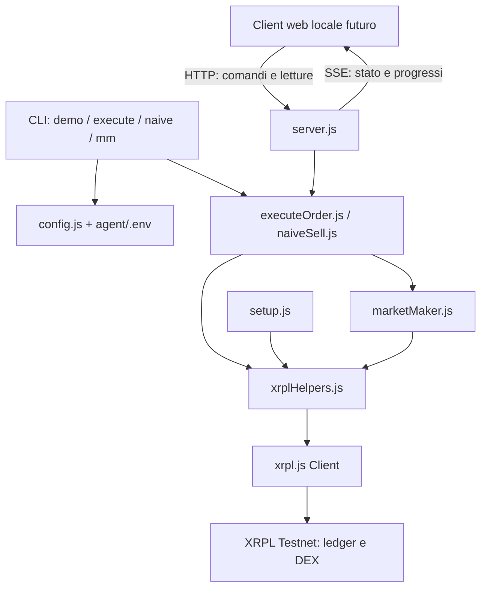

# TreasuryGuard — guida al progetto

> Documento di orientamento e apprendimento per la repository **IXH26-project**. Descrive ciò che è presente nel codice, spiega i concetti XRPL necessari per leggerlo e separa l’implementazione attuale dalle idee di prodotto ancora da realizzare. Aggiornare questa guida quando cambiano architettura, flussi o comportamento.

## 1. In breve

TreasuryGuard è una prova di concetto di un execution engine per vendere un token IOU sul DEX nativo di XRP Ledger (XRPL). Il problema modellato è quello di una tesoreria che vende una quantità elevata: un ordine grande può consumare i bid migliori e ottenere prezzi progressivamente peggiori, cioè subire slippage.

Il progetto rende confrontabili due strategie:

- **Naive**: un unico ordine di vendita per l’intera quantità, senza soglia di prezzo.
- **Guarded**: misura il book, calcola un prezzo minimo in base alla tolleranza scelta e vende in chunk con un limite verificato dal ledger.

La demo gira su **XRPL Testnet** e usa un market maker controllato dal progetto per creare e ricostituire la liquidità. Di conseguenza, il risultato dimostra il funzionamento del meccanismo in un mercato simulato: non è una misura di performance su liquidità reale.

## 2. Stato del progetto: implementato e previsto

### Presente nella repository

- Agente Node.js con `xrpl.js` per connettersi alla Testnet, preparare wallet e token, leggere il book e inviare transazioni.
- Market maker dimostrativo che pubblica un ladder di bid a prezzi configurati e ripristina i livelli consumati.
- Vendita naive e motore di vendita protetta con prezzo minimo, chunk adattivi, attesa della liquidità e riepilogo dei fill.
- Demo CLI che esegue il confronto tra le due strategie.
- Bridge HTTP locale con endpoint per stato, book, reset ed esecuzione; gli aggiornamenti dell’agente sono trasmessi con Server-Sent Events (SSE).
- Controllo pre-demo (`doctor.js`) che verifica runtime, configurazione locale, connessione Testnet, wallet, liquidità e bridge.
- Test automatici offline per helper XRPL e contratto HTTP di validazione/accesso del bridge.
- Replay offline di esecuzioni registrate, con due esempi curati e salvataggio locale dei run live.

### Non presente ancora

- L’interfaccia web descritta nel pitch: `frontend/` contiene solo un segnaposto (`.gitkeep`), non un’applicazione.
- Deposito o custodia di token da parte di utenti, gestione di mandati multiutente o un backend di produzione.
- Protezione privata o garanzia contro front-running/MEV. L’ordine, la soglia e le transazioni XRPL restano visibili secondo il normale funzionamento del ledger.
- Smart Escrow, XLS-0100, circuiti RISC Zero o prove ZK. Sono idee di evoluzione menzionate nel README, non componenti implementati.
- Copertura automatizzata end-to-end sul ledger: i test attuali sono offline e non verificano transazioni reali, esecuzioni complete o comportamento del market maker su Testnet.

Il pitch del README di root è quindi una visione di prodotto; per capire il comportamento esistente, fare riferimento ai moduli in `agent/` e alla guida operativa in `agent/README.md`.

## 3. Mappa della repository

| Percorso | Responsabilità |
|---|---|
| `README.md` | Pitch, problema, proposta di soluzione e idee di prodotto. Include anche elementi futuri. |
| `agent/README.md` | Avvio rapido, comandi, configurazione, note XRPL e API del bridge. |
| `agent/package.json` / `agent/package-lock.json` | Dipendenze, comandi npm, versione minima Node e lock delle dipendenze. |
| `agent/config.js` | Carica `agent/.env`, definisce rete, token, wallet e parametri del book e dell’esecuzione. |
| `agent/.env.example` | Esempio documentato delle variabili; i seed reali vengono salvati in `agent/.env`. |
| `agent/setup.js` | Crea i tre wallet di test, configura l’issuer, crea trust line, emette token e salva i seed. |
| `agent/xrplHelpers.js` | Connessione, formattazione importi, lettura book e saldi, analisi dei fill, invio batch e top-up. |
| `agent/marketMaker.js` | Crea, rifinanzia e descrive i bid del market maker simulato. |
| `agent/naiveSell.js` | Un singolo ordine di vendita senza floor e stampa del riepilogo. |
| `agent/executeOrder.js` | Algoritmo guarded, eventi di avanzamento e riepilogo finale. |
| `agent/demo.js` | Esecuzione end-to-end naive vs guarded sul book dimostrativo. |
| `agent/server.js` | Bridge HTTP/SSE per collegare un client web locale all’engine. |
| `agent/doctor.js` | Controlli di preparazione prima della demo; termina con codice 1 se trova un blocco. |
| `agent/test/xrplHelpers.test.js` | Test offline per conversioni, costruzione IOU, prezzo dei bid e gestione di fill uccisi. |
| `agent/test/server.test.js` | Test offline per risposte HTTP, validazione input, CORS, lock, replay e modalità offline. |
| `agent/recordings/demo-naive.json`, `agent/recordings/demo-guarded.json` | Registrazioni curate per riprodurre le demo senza connessione XRPL. |
| `agent/recordings/live/` | Registrazioni create dal bridge dopo un run live; cartella esclusa da Git. |
| `agent/connect-test.js` | Smoke check manuale di connessione e faucet Testnet. |
| `docs/` | Guide e documentazione del repository; questa guida è il riferimento introduttivo. |
| `frontend/` | Directory predisposta, ma senza implementazione applicativa al momento. |

## 4. Architettura e dipendenze tra moduli



`config.js` è importato dai moduli e fornisce configurazione condivisa. `xrplHelpers.js` contiene le operazioni XRPL riutilizzabili. `executeOrder.js`, `naiveSell.js`, `marketMaker.js` e `server.js` possono essere importati senza avviare nulla: `isMain(import.meta.url)` fa partire `main()` solo quando il file viene eseguito direttamente. `demo.js`, `setup.js`, `doctor.js` e `connect-test.js` non hanno questa protezione: eseguono il comando appena vengono importati, quindi non vanno importati da altri moduli. Questa separazione permette a `server.js` di comporre le funzioni dell’engine.

Dipendenze runtime dichiarate: `xrpl` 5.x e `dotenv`; il progetto richiede Node.js 20.19 o successivo. Il bridge usa `node:http` e `node:crypto` integrati in Node, senza framework HTTP aggiuntivi. I test usano `node:test` e `node:assert` integrati in Node.

Per accelerare la pubblicazione del ladder, `submitMany()` usa un solo `autofill()` per ricavare fee, `LastLedgerSequence` e sequenza iniziale; firma le transazioni con sequenze consecutive e le invia in parallelo in batch fino a 10. Aspetta poi la validazione di ogni hash. Questa ottimizzazione riduce i round trip necessari al seeding, ma dipende dal comportamento della coda transazioni di XRPL.

## 5. Concetti XRPL utili per leggere il codice

### XRP, drop e IOU

XRP è l’asset nativo e nelle transazioni viene espresso in **drop**: 1 XRP = 1.000.000 drop. `toDrops()` converte gli XRP in una stringa di drop interi. Il token TGD della demo è invece un **IOU** (un asset emesso da un account issuer) e viene identificato dalla coppia `currency` + `issuer`, con importo rappresentato come oggetto `{ currency, issuer, value }`.

Il ticker standard XRPL è lungo tre caratteri; `TGD` rispetta questa regola. La stringa `TOKEN` richiederebbe una rappresentazione valuta estesa. `formatIou()` evita notazione esponenziale e limita le cifre significative nel serializzare gli importi.

### Issuer e trust line

L’**issuer** emette il token. Un altro account deve creare una **trust line** verso quell’issuer prima di poter detenere l’IOU. `setup.js` prepara issuer, tesoreria e market maker; imposta `asfDefaultRipple` sull’issuer prima di creare le trust line, poi crea le linee per tesoreria e market maker e trasferisce i token alla tesoreria.

Questi wallet e seed sono soltanto per Testnet. `.gitignore` esclude i file `.env`; `agent/.env.example` è un modello senza seed. Non inserire mai seed Mainnet in questa configurazione.

### OfferCreate e direzione del book

Un `OfferCreate` specifica cosa l’account cede (`TakerGets`) e cosa vuole ricevere (`TakerPays`). Nel book usato dal progetto i bid sono offerte di compratori che pagano XRP per ricevere TGD. Di conseguenza `getBids()` richiede XRP in `taker_gets` e TGD in `taker_pays`.

`book_offers.quality` non viene usato come prezzo XRP/TGD: la sua unità è token per drop in questa direzione del book. `getBids()` ricava il prezzo come `XRP / token` dagli importi dell’offerta, usando i campi funded quando presenti per riflettere la quantità realmente finanziata.

### IOC, Sell e validazione

Le vendite usano `tfImmediateOrCancel` (IOC): l’offerta viene eseguita subito per la parte abbinabile e la parte restante viene annullata, quindi non resta come ordine aperto nel book. `tfSell` indica che l’ordine vende l’intero importo `TakerGets`, anche se ottiene più XRP dell’importo richiesto in `TakerPays`.

Le transazioni vengono inviate al ledger e poi misurate dai metadati validati. `parseFill()` usa `xrpl.getBalanceChanges()` per determinare quanti token sono usciti e quanti XRP sono entrati; riaggiunge la fee XRP alla variazione di saldo per stimare i proventi della vendita al lordo della fee. Questo evita di basare il riepilogo soltanto su quantità richieste o prezzi teorici.

## 6. I tre wallet e il ciclo della demo

1. `npm run setup` crea **issuer**, **treasury** e **market maker** tramite faucet Testnet. Finanzia anche il market maker per sostenere gli XRP del ladder e le riserve di account.
2. L’issuer crea le trust line e invia TGD alla tesoreria.
3. `seedLadder()` pubblica un livello di bid per ogni configurazione in `LADDER`. Il market maker usa `OfferSequence` per sostituire atomicamente gli ordini esistenti dove possibile e cancella eventuali offerte in eccesso.
4. La vendita naive consuma il book con un unico IOC. Poiché il ladder ha livelli più bassi, un ordine grande può ricevere un prezzo medio inferiore al miglior bid iniziale.
5. La demo ripristina il ladder e avvia il ciclo di refill del market maker. L’engine guarded esegue chunk limitati dal prezzo minimo mentre il market maker reintegra i livelli consumati ai prezzi configurati.
6. Al termine, la demo confronta token venduti, XRP ricevuti, prezzo medio, slippage e durata.

Il market maker non rappresenta domanda indipendente: è un attore controllato dal progetto e ripristina la liquidità a prezzi fissi. Questa ipotesi spiega perché il percorso guarded può apparire molto migliore nella demo. Senza refill, la suddivisione da sola non crea liquidità né migliora il prezzo medio rispetto alla profondità disponibile.

## 7. Come funziona il motore guarded

In `executeOrder(client, wallet, totalAmount, maxSlippagePercent, options)`, i valori percentuali sono espressi come numeri percentuali: `0.5` significa 0,5%.

1. **Controllo saldo e book**: legge il saldo token della tesoreria e rifiuta quantità superiori; poi legge i bid. Un book vuoto interrompe l’esecuzione.
2. **Prezzo di riferimento**: prende il miglior bid iniziale, `referencePrice`.
3. **Price floor**: calcola `minPrice = referencePrice × (1 − maxSlippagePercent / 100)`. Per esempio con 0,5%, la vendita non accetta offerte inferiori al 99,5% del prezzo di riferimento.
4. **Liquidità in banda**: prima di ogni chunk rilegge i bid ed esclude quelli posseduti dalla tesoreria. Somma i token disponibili con prezzo `>= minPrice`.
5. **Attesa o stop**: se la liquidità sicura è inferiore al minimo necessario, aspetta e ripete la lettura ogni `POLL_MS`. Se non torna entro `LIQUIDITY_TIMEOUT_MS`, termina `halted`, potenzialmente con fill parziale.
6. **Dimensione del chunk**: limita la vendita al rimanente e a `CHUNK_MAX`; normalmente usa `PARTICIPATION` della liquidità in banda, con un minimo coerente con `MIN_CHUNK`.
7. **Ordine protetto**: invia un `OfferCreate` IOC + Sell, offrendo il chunk di TGD e impostando `TakerPays` a `chunk × minPrice` XRP. Il rapporto tra importo venduto e importo XRP richiesto definisce il limite di cambio dell’ordine, che viene valutato dal ledger; il motore non si affida soltanto a una decisione lato JavaScript.
8. **Contabilità e progressi**: dopo la validazione legge i metadati, aggiorna totale venduto e XRP ricevuti e calcola prezzo medio, slippage e percentuale completata.
9. **Condizioni di arresto**: un chunk senza fill viene conteggiato come kill; dopo cinque kill consecutivi l’esecuzione si ferma. L’engine verifica anche lo slippage medio come salvaguardia e chiude con evento `done`.

La soglia on-chain limita il prezzo accettato per i chunk. L’engine può comunque terminare senza vendere tutta la quantità se non c’è liquidità sicura o se il tempo di attesa scade. Il campo `status` del riepilogo distingue `completed` da `halted`; controllare anche `sold`, `reason` e `slippagePct` prima di interpretare un run come completato integralmente.

### Strategia naive

`naiveSell()` usa un singolo ordine IOC + Sell per tutti i token richiesti e imposta `TakerPays: "1"` drop: in pratica non impone una soglia economica significativa. Può quindi attraversare più livelli del book fino alla quantità disponibile. La funzione restituisce i dati osservati dai metadati, il prezzo di riferimento iniziale e lo slippage rispetto a quel riferimento.

## 8. Eventi dell’engine e bridge web

`executeOrder()` accetta `onEvent`; per impostazione predefinita `logEvent()` stampa gli eventi nel terminale. Gli eventi principali sono `start`, `waiting`, `killed`, `chunk`, `halt` e `done`. L’evento `chunk` include progresso, quantità, XRP ricevuti, prezzo medio, slippage e hash della transazione.

`server.js` espone una piccola API locale:

| Metodo e percorso | Comportamento |
|---|---|
| `GET /health` | Stato occupato/libero, run corrente, ultimo run e numero di subscriber SSE. |
| `GET /book` | Bid correnti e configurazione del ladder. |
| `POST /reset` | Ripubblica il ladder in background; risponde `202` con `runId`. |
| `POST /execute` | Avvia modalità `naive` o `guarded`; risponde `202` e trasmette l’avanzamento. |
| `POST /replay` | Riproduce una registrazione curata senza interagire con il ledger; risponde `202`. |
| `GET /events` | Stream SSE; invia `hello`, `run:start`, eventi dell’engine e `run:end`. |

`POST /execute` accetta `{ "mode": "naive" | "guarded", "amount": numero, "maxSlippage": percentuale, "reset": boolean }`. Un solo reset o run può essere attivo; richieste concorrenti ricevono `409`. Il server verifica JSON, dimensione del body, intervalli numerici e origine browser consentita. Le richieste senza header `Origin` (ad esempio curl) sono ammesse. Gli origin predefiniti sono localhost sulle porte 3000; per Vite è necessario aggiungere la porta effettiva a `ALLOWED_ORIGINS`.

Il server avvia una connessione XRPL e carica i wallet all’avvio. Il tentativo di connessione ha un timeout di 10 secondi; se fallisce, il server resta avviato offline. Prima dell’esecuzione live fa un top-up della tesoreria se necessario. La modalità naive ripristina il ladder per default (`reset: false` lo disabilita); la modalità guarded parte sempre da un ladder nuovo e fa girare il market maker durante la vendita. L’evento `seeding` segnala l’attesa di preparazione del book, attualmente circa 8–10 secondi sulla Testnet. La modalità naive non produce progressi per chunk: un client può aggiornare il book facendo polling di `/book`.

Il bridge è pensato per sviluppo locale, non è un servizio multiutente o un endpoint di produzione. `SERVER_HOST` è `127.0.0.1` per default; gli origin ammessi non sostituiscono un sistema di autenticazione se il servizio venisse esposto oltre il computer locale.

### Registrazione e replay

Durante un’esecuzione live, il bridge registra gli eventi engine con il tempo trascorso, i parametri e il risultato finale. Al completamento salva un JSON in `agent/recordings/live/`, escluso da Git. Le registrazioni curate nella radice di `agent/recordings/` vengono servite da `POST /replay`; i nomi accettano solo lettere, numeri e trattini, così non possono selezionare percorsi arbitrari.

Il body è `{ "name": "demo-guarded", "speed": 1 }`. `speed` deve essere maggiore di 0 e al massimo 100; il default è 1. Gli intervalli lunghi sono comunque accorciati a 2,5 secondi, quindi il replay mantiene la forma temporale degli eventi ma può essere più breve della registrazione originale. Il replay acquisisce il lock come `kind: "execute"`, conserva la forma generale dei parametri live e termina con `run:end`; il frontend può riutilizzare il normale flusso SSE.

Le registrazioni attualmente incluse sono esempi fissati, non dati di mercato aggiornati. `demo-naive` registra 100.000 TGD venduti, 8,644 XRP ricevuti e circa 13,56% di slippage. `demo-guarded` registra 100.000 TGD venduti in 5 chunk, 9,99 XRP ricevuti e circa 0,10% di slippage con mandato 0,5%. Sono riproduzioni di demo su Testnet con liquidità simulata, non risultati garantiti per un run nuovo.

### Modalità offline

`npm run server -- --offline` avvia il bridge senza tentare la connessione XRPL. Senza questo flag il bridge prova a connettersi per 10 secondi, poi rimane in modalità offline se la connessione fallisce. Lo stato `online` è esposto da `/health` e dall’evento SSE `hello`.

In offline, `/health`, `/events` e `/replay` restano utilizzabili. `GET /book` restituisce il ladder configurato con `offline: true`, quindi è una rappresentazione statica, non il book corrente del ledger. `POST /execute` e `POST /reset` rispondono `503` e indicano di usare il replay. Per tornare online occorre riavviare il server con rete e credenziali disponibili.

## 9. Avvio e comandi

Requisiti: Node.js >= 20.19 e dipendenze installate. La Testnet e `agent/.env` con i seed servono per setup, demo live, market maker ed esecuzione live; replay e server offline funzionano senza wallet o connessione XRPL.

```bash
cd agent
npm ci
npm run setup
npm run demo
```

`setup` crea le credenziali una volta e rifiuta di sovrascrivere seed già presenti. `npm run setup -- --force` crea un nuovo set e aggiorna `agent/.env`.

| Comando da `agent/` | Uso |
|---|---|
| `npm run connect-test` | Verifica connessione e faucet. |
| `npm run setup` | Inizializza wallet e token di test. |
| `npm run mm` | Pubblica il ladder e lo ricarica continuamente; Ctrl+C per fermare. |
| `npm run mm -- --seed` | Pubblica una volta e termina. |
| `npm run naive -- 100000` | Esegue una vendita naive. |
| `npm run execute -- 100000 0.5` | Esegue guarded; avviare prima `npm run mm` in un altro terminale. |
| `npm run execute -- 100000 0.5 --with-mm` | Avvia market maker e guarded nello stesso processo. |
| `npm run demo` | Confronto end-to-end naive e guarded. |
| `npm run server` | Avvia il bridge locale su `127.0.0.1:8787`. |
| `npm run server -- --offline` | Avvia il bridge senza contattare Testnet; disponibile il replay e un book statico. |
| `npm test` | Esegue i test offline definiti in `agent/test/`; non invia transazioni né contatta il ledger. |
| `npm run doctor` | Controlla se ambiente e Testnet sono pronti per la demo; warning non bloccanti non causano codice d’uscita 1. |

Il risultato numerico riportato in `agent/README.md` è un esempio registrato su Testnet, non un benchmark stabile: book, validazione, faucet e stato di rete possono variare.

## 10. Configurazione

Le variabili sono lette da `agent/.env`; i default e i commenti sono in `agent/.env.example`.

| Variabile | Significato |
|---|---|
| `XRPL_NETWORK` | URL WebSocket XRPL; default Testnet. |
| `TOKEN_CURRENCY`, `TOKEN_ISSUER` | Codice e issuer dell’IOU dimostrativo. |
| `ISSUER_SEED`, `TREASURY_SEED`, `MM_SEED` | Seed dei tre wallet Testnet, generati da `setup.js`. |
| `BASE_PRICE` | Miglior prezzo configurato del ladder, in XRP per token. |
| `LADDER_DROPS_PCT` | Ribasso percentuale di ciascun livello rispetto al prezzo base. |
| `LADDER_SIZES` | Quantità di token offerta in ogni livello; stessa lunghezza della lista dei ribassi. |
| `MM_INTERVAL_MS` | Intervallo del ciclo di controllo/refill. |
| `DEMO_AMOUNT`, `MAX_SLIPPAGE_PCT` | Valori predefiniti della demo e del mandato guarded. |
| `CHUNK_MAX`, `PARTICIPATION`, `MIN_CHUNK` | Tetto e logica di dimensionamento dei chunk. |
| `POLL_MS`, `LIQUIDITY_TIMEOUT_MS` | Frequenza di rilettura del book e attesa massima della liquidità. |
| `TREASURY_MINT` | Quantità minima usata da `topUpTreasury()` quando serve un’emissione aggiuntiva. |
| `SERVER_HOST`, `SERVER_PORT`, `ALLOWED_ORIGINS` | Binding, porta e origin browser consentiti dal bridge. |

I valori di `LADDER_DROPS_PCT` e `LADDER_SIZES` devono avere lo stesso numero di elementi. Il totale token del ladder è la somma delle size; gli XRP necessari dipendono da `size × price` per ogni livello, oltre a riserve ledger e fee.

## 11. Note operative e limiti interpretativi

- **Il refill è l’assunzione centrale della demo.** Prezzi fissi e liquidità rigenerata sono intenzionali, ma non descrivono un market maker esterno che accetta di ricomprare a quei livelli.
- **Slippage qui è una metrica relativa al miglior bid iniziale.** Il codice calcola `(referencePrice - avgPrice) / referencePrice × 100`. Può risultare negativo se il prezzo medio supera il riferimento.
- **Fill parziale non equivale a ordine completato.** Controllare `status`, `reason` e quantità `sold` rispetto a `totalAmount`.
- **Il prezzo-floor è applicato a ogni chunk.** Ciò protegge dal ricevere meno del limite per i fill dell’offerta; la disponibilità di liquidità e l’esito completo restano condizioni separate.
- **Il refill e i test di rete dipendono da Testnet e faucet.** Il faucet può essere rate-limited; il codice tenta il top-up e restituisce un errore leggibile se fallisce.
- **Ordini e dati di mercato sono pubblici.** Non descrivere l’attuale motore come privato o resistente al MEV.
- **Portata dei test.** I test coprono funzioni pure e percorsi HTTP di validazione/accesso, replay e comportamento offline; non sostituiscono una prova d’integrazione con wallet, transazioni e book reali su Testnet.
- **Credenziali.** `agent/.env` è escluso da Git. Conservare solo seed Testnet e non condividere il file.

## 12. Come mantenere questa guida

Quando il progetto evolve, aggiornare in questo file almeno: mappa dei moduli, flusso end-to-end, parametri dell’engine, API bridge, stato delle funzionalità e limiti della demo. Se una parte futura diventa implementata, spostarla da “Non presente ancora” alla sezione pertinente e indicare dove si trova nel codice. Tenere `agent/README.md` focalizzato sull’avvio e sui dettagli operativi, e questa guida focalizzata sull’apprendimento e sul quadro complessivo.
